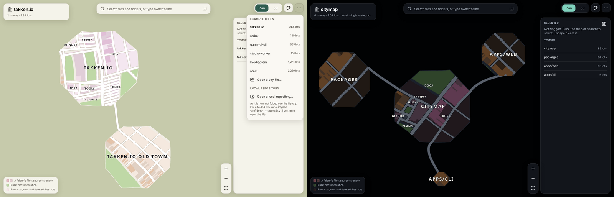
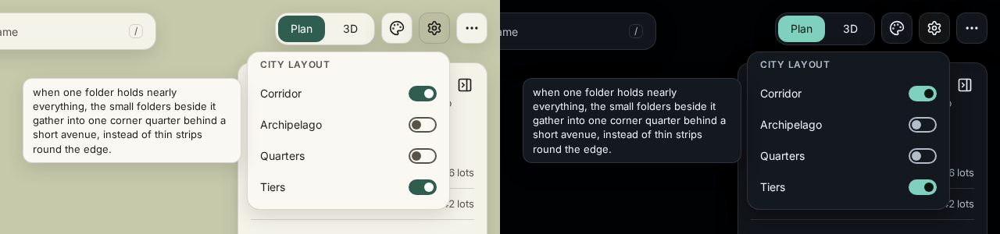
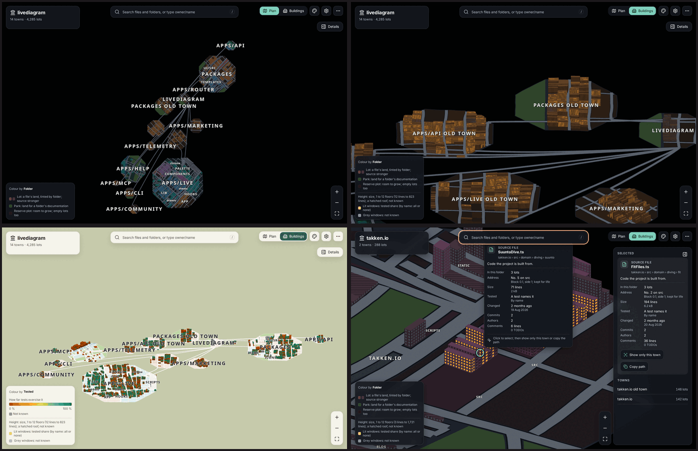
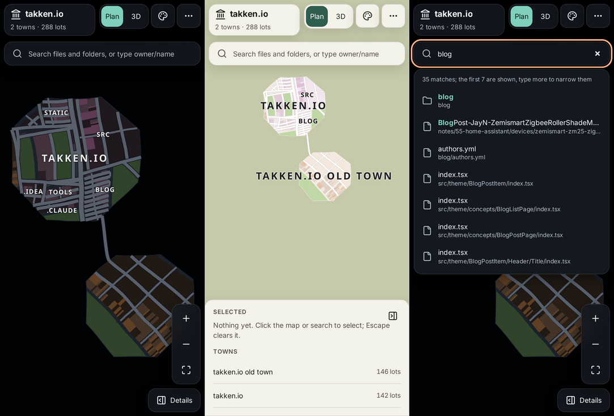

# citymap

Turn a git repository into a city map.

Folders become towns and districts, files become lots, and the history decides where everything sits. The map stays
stable as the code grows, so the place you knew yesterday is still there today.


## Try it live

Open **[webbertakken.github.io/citymap](https://webbertakken.github.io/citymap/)** and type any public GitHub repository
(`owner/name`) into the search box. Its current state is read from GitHub and laid in your browser, in a second or two
for most repositories (linux: 96,000 files in about 14 seconds). A link such as
[?repo=facebook/react](https://webbertakken.github.io/citymap/?repo=facebook/react) opens one directly.

A large repository shows its progress over the map as it is read and laid, and Cancel (or Escape) stops it. After
`owner/`, the search suggests that owner's public repositories.

The live page shows a single state; folding the whole history, which keeps the map stable over time, runs with the CLI.
GitHub allows about 60 requests an hour without signing in: most repositories take two, linux about thirty, and an
owner's suggestions one; the search says how many are left.

### A repository on your own machine

Under **More**, **Open a local repository…** asks for a repository's folder and lays it in the page, without a GitHub
account and without installing anything. The page reads the repository's git index, so exactly the files git tracks
become the city (no `node_modules`, no build output), the same city as `citymap --no-history`; a folder without git
honours its `.gitignore` files. Nothing leaves your machine: no request, nothing in the address, and the tab's title
keeps the name to your own screen.



- **Chrome and Edge** read only the index and a few small files, and remember the folder for next time (the browser asks
  again before reading it). linux opens in about 4 seconds.
- **Firefox** lists every file in the folder first, which takes a few seconds for a large one (linux: about 9 in all).
- **Safari** hides `.git` and `.gitignore` from pages, so it is not offered there; use another browser or the CLI.
- Like a GitHub repository, it shows the single state; fold its history with the CLI and open the city file.

## What it does

- **Stable by design.** citymap folds a repository's whole first-parent history: the recent commits one by one, older
  ones in windows. Every cut, grid and address it lays is remembered, so a commit only moves the folders it touches.
  Across the reference repositories about one lot in a hundred moves per commit.

  

- **A town for every app.** Workspace members come from the repository's own manifests (npm, pnpm, Yarn, Bun, Lerna,
  Cargo, go.work, uv, Deno). Each app in `apps/` becomes its own town; other groups, such as `packages/`, form one town
  each. When an archetype changes, the old town is kept whole beside the new one.
- **Roads that mean something.** Every cut between folders is a road, classed by the size of the land it divides: lanes
  and streets inside neighbourhoods, collectors and avenues between districts, one boulevard through a city. Road shares
  are checked against 68 real settlements of matching size.
- **Four layout toggles.** Some repositories have a shape of their own, and four archetypes answer it. Corridor and
  tiers are on by default; archipelago and quarters are a switch away, with `--toggles=` in the CLI or behind the
  viewer's settings cog, which loads each bundled city as laid with the switches chosen.
  - **Corridor**: when one folder holds nearly everything, the small folders beside it gather into one corner quarter
    behind a short avenue, instead of thin strips round the edge.
  - **Archipelago**: a folder of packages becomes islands, one per package, with canals and bridges between them instead
    of roads.
  - **Quarters**: many similar small folders are grouped into planned quarters, each a tidy grid of blocks square to its
    own outline, so you get neighbourhoods rather than stripes.
  - **Tiers**: a town's size sets its widest road, and only one road per town gets that class; every other road is at
    least one class narrower.

  

  

- **Docs are parks, tests are off the map** by default (`--tests` gives them land), and deleted files leave vacant lots
  until their neighbourhood renews.
- **Any size.** Very large repositories can be shown as a single state, without their history:

  

- **Buildings that show health.** Every lot carries a building. In the viewer's Buildings view it stands as tall as its
  files are big (1 to 12 floors, on a scale fitted to the city), its floors' windows lit as far as its tests reach, and
  coloured by its folder or, from the legend's "Colour by", by how tested, big, recent, often changed or widely written
  it is, or by its kind. What a city can tell depends on where it came from: a GitHub repository live gives sizes and
  finds tests by their names; a folder on your machine adds lines, comments and a coverage report if one is there; the
  CLI adds when, how often and by how many people each file changed, from the history it folds, and reads coverage
  reports in LCOV, Istanbul JSON, Cobertura and JaCoCo (`--coverage=<file>`, or where your tools write them). What is
  not known says so, never zero.

  

- **Themes and views.** Five themes (Paper atlas, Night atlas, Beck, Nolli, Dracula), plan view and the Buildings view
  in the viewer, plan or 2:1 dimetric 3D in the SVG export, and optional Voronoi district regions.

  

- **A viewer.** The map fills the page and every control floats over it, light or dark as your system prefers. Search
  for any file or folder and the map flies to it; pan, zoom, hover over anything to learn what it is and what it means,
  click to select it and copy its path (or, for a city from GitHub, open it there), and drill into one town. Press `/`
  to search from anywhere.

  

  On a phone the details fold into a sheet:

  

## Quick start

You need [Bun](https://bun.sh) and git.

```bash
bun install
```

Draw a repository as an SVG:

```bash
bun apps/cli/src/bin.ts ~/path/to/repo --svg=city.svg
```

Explore cities in the browser:

```bash
bun run --cwd apps/web dev
```

The viewer opens with a few bundled cities. Drop any city file the CLI wrote (`--out=city.json`) onto the page to see
your own.

## The CLI

```bash
bun apps/cli/src/bin.ts <repository> [options]
```

| Option              | What it does                                                           |
| ------------------- | ---------------------------------------------------------------------- |
| `--svg=<file>`      | Write the city as an SVG                                               |
| `--out=<file>`      | Write the city as JSON, for the viewer                                 |
| `--theme=<name>`    | `paper-atlas`, `night-atlas`, `beck`, `nolli`, `dracula`               |
| `--camera=<view>`   | `plan` or `dimetric`                                                   |
| `--to=<ref>`        | Draw the city as it was at that commit                                 |
| `--lock`            | Save progress in `citymap.lock.json`, and resume from it               |
| `--no-history`      | Lay one state, every file at once, without folding the history         |
| `--voronoi`         | Fill each folder's region beneath its blocks                           |
| `--split=<groups>`  | Which workspace groups become a town per member (default `apps`)       |
| `--toggles=<list>`  | Archetype toggles on (default `corridor,tiers`; `--toggles=` for none) |
| `--coverage=<file>` | A coverage report to read for how tested each file is (repeatable)     |
| `--no-measures`     | Write the city without its measures                                    |
| `--help`            | Show every option                                                      |

A long history folds its last 1,000 to 1,999 commits one by one and older ones in windows of 100 commits (of 1,000
beyond the last 10,000), so a full fold takes seconds for small repositories and minutes for the largest: react (15,000
commits) in under a minute, next.js (32,000) in under 3 minutes, linux (77,000) in about 16. Histories under 2,000
commits fold every commit. `--lock` saves progress, so later runs fold only the new commits; `--no-history` lays any
single state in seconds.

## What is in here

| Folder                 | Contents                                                                  |
| ---------------------- | ------------------------------------------------------------------------- |
| `packages/ground-plan` | The layout engine: integer-only and deterministic                         |
| `packages/history`     | Reads git history and workspace manifests                                 |
| `packages/measures`    | Measures of each file: sizes, tests, coverage reports, history            |
| `packages/scene`       | Turns a city into 3D layers                                               |
| `packages/svg`         | Draws a city as an SVG                                                    |
| `packages/themes`      | The colour themes                                                         |
| `apps/cli`             | The `citymap` command                                                     |
| `apps/web`             | The viewer                                                                |
| `docs`                 | Specs, blueprints and research: start at [docs/README.md](docs/README.md) |

## Developing

```bash
bun run check   # format, lint, typecheck and tests with coverage
bun run bench   # performance budgets and the corpus ratchet, on local clones
```

See [docs/instructions/development.md](docs/instructions/development.md) for the full loop.

## Licence

[MIT](LICENSE)
