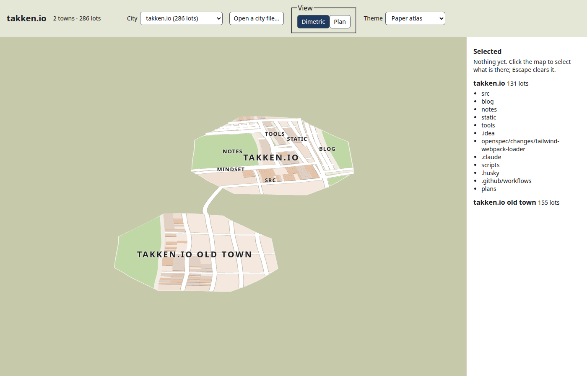

# citymap

Turn a git repository into a city map.

Folders become towns and districts, files become lots, and the history decides where everything sits. The map stays
stable as the code grows, so the place you knew yesterday is still there today.



## Quick start

You need [Bun](https://bun.sh) and git.

```bash
bun install
```

Draw a repository as an SVG:

```bash
bun apps/cli/src/bin.ts ~/path/to/repo --svg=city.svg
```

Explore cities in the browser:

```bash
bun run --cwd apps/web dev
```

The viewer opens with a few bundled cities. Drop any city file the CLI wrote (`--out=city.json`) onto the page to see
your own.

## The CLI

```bash
bun apps/cli/src/bin.ts <repository> [options]
```

| Option            | What it does                                             |
| ----------------- | -------------------------------------------------------- |
| `--svg=<file>`    | Write the city as an SVG                                 |
| `--out=<file>`    | Write the city as JSON, for the viewer                   |
| `--theme=<name>`  | `paper-atlas`, `night-atlas`, `beck`, `nolli`, `dracula` |
| `--camera=<view>` | `plan` or `dimetric`                                     |
| `--to=<ref>`      | Draw the city as it was at that commit                   |
| `--lock`          | Save progress in `citymap.lock.json`, and resume from it |
| `--help`          | Show every option                                        |

## What is in here

| Folder                 | Contents                                                                  |
| ---------------------- | ------------------------------------------------------------------------- |
| `packages/ground-plan` | The layout engine: integer-only and deterministic                         |
| `packages/history`     | Reads git history                                                         |
| `packages/scene`       | Turns a city into 3D layers                                               |
| `packages/svg`         | Draws a city as an SVG                                                    |
| `packages/themes`      | The colour themes                                                         |
| `apps/cli`             | The `citymap` command                                                     |
| `apps/web`             | The viewer                                                                |
| `docs`                 | Specs, blueprints and research: start at [docs/README.md](docs/README.md) |

## Developing

```bash
bun run check   # format, lint, typecheck and tests with coverage
```

See [docs/instructions/development.md](docs/instructions/development.md) for the full loop.
