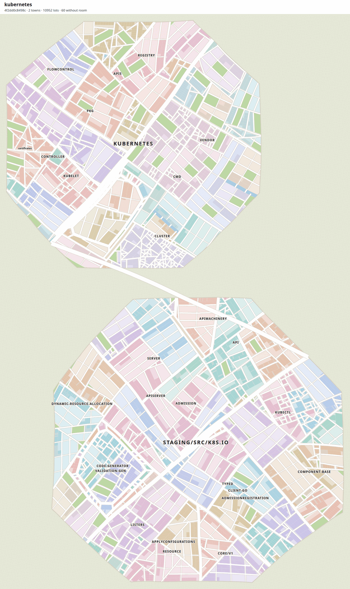
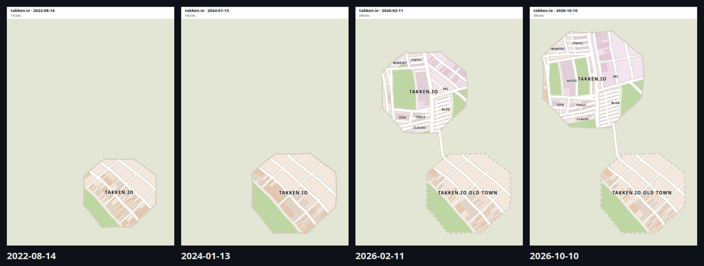
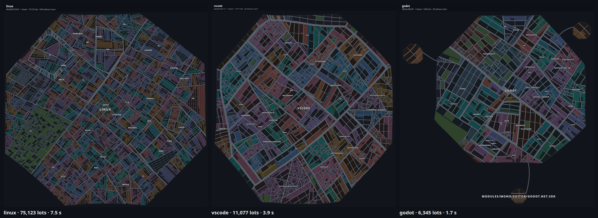
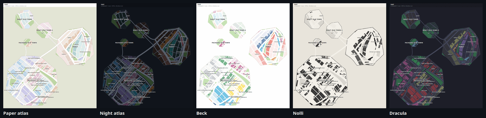
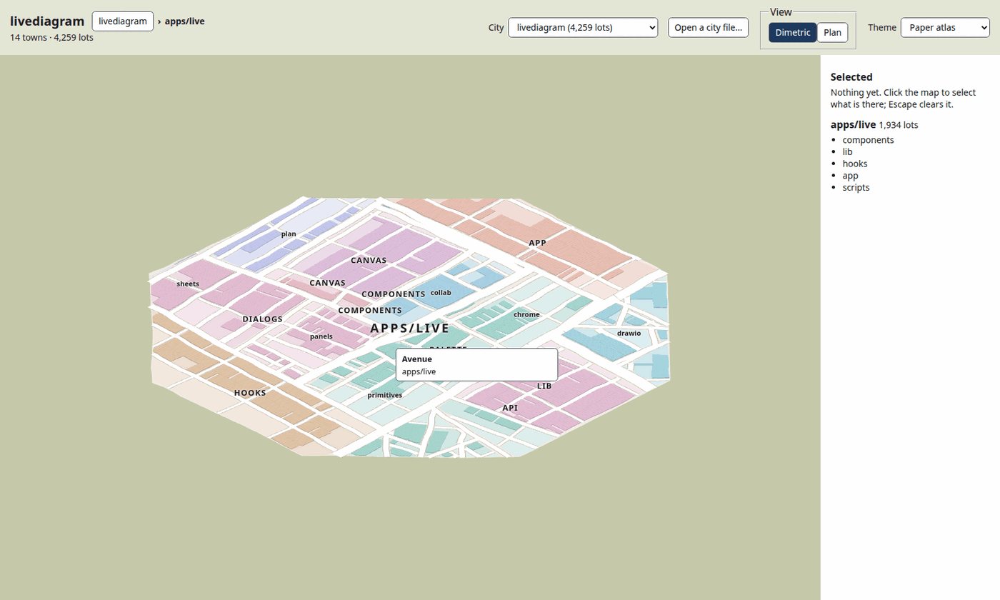

# citymap

Turn a git repository into a city map.

Folders become towns and districts, files become lots, and the history decides where everything sits. The map stays
stable as the code grows, so the place you knew yesterday is still there today.



## Try it live

Open **[webbertakken.github.io/citymap](https://webbertakken.github.io/citymap/)** and type any public GitHub repository
(`owner/name`) into the bar. Its current state is read from GitHub and laid in your browser, in a second or two for most
repositories (linux: 96,000 files in about 14 seconds). A link such as
[?repo=facebook/react](https://webbertakken.github.io/citymap/?repo=facebook/react) opens one directly.

The live page shows a single state; folding the whole history, which keeps the map stable over time, runs with the CLI.
GitHub allows about 60 requests an hour without signing in: most repositories take two, linux about thirty.

## What it does

- **Stable by design.** citymap folds a repository's whole first-parent history, commit by commit. Every cut, grid and
  address it lays is remembered, so a commit only moves the folders it touches. Across the reference repositories about
  one lot in a hundred moves per commit.

  

- **A town for every app.** Workspace members come from the repository's own manifests (npm, pnpm, Yarn, Bun, Lerna,
  Cargo, go.work, uv, Deno). Each app in `apps/` becomes its own town; other groups, such as `packages/`, form one town
  each. When an archetype changes, the old town is kept whole beside the new one.
- **Roads that mean something.** Every cut between folders is a road, classed by the size of the land it divides: lanes
  and streets inside neighbourhoods, collectors and avenues between districts, one boulevard through a city. Road shares
  are checked against 68 real settlements of matching size.
- **Docs are parks, tests are off the map** by default (`--tests` gives them land), and deleted files leave vacant lots
  until their neighbourhood renews.
- **Any size.** Very large repositories can be shown as a single state, without their history:

  

- **Themes and views.** Five themes (Paper atlas, Night atlas, Beck, Nolli, Dracula), plan or 2:1 dimetric, and optional
  Voronoi district regions.

  

- **A viewer.** Pan, zoom, hover to name anything, click to select, and drill into one town.

  

## Quick start

You need [Bun](https://bun.sh) and git.

```bash
bun install
```

Draw a repository as an SVG:

```bash
bun apps/cli/src/bin.ts ~/path/to/repo --svg=city.svg
```

Explore cities in the browser:

```bash
bun run --cwd apps/web dev
```

The viewer opens with a few bundled cities. Drop any city file the CLI wrote (`--out=city.json`) onto the page to see
your own.

## The CLI

```bash
bun apps/cli/src/bin.ts <repository> [options]
```

| Option             | What it does                                                     |
| ------------------ | ---------------------------------------------------------------- |
| `--svg=<file>`     | Write the city as an SVG                                         |
| `--out=<file>`     | Write the city as JSON, for the viewer                           |
| `--theme=<name>`   | `paper-atlas`, `night-atlas`, `beck`, `nolli`, `dracula`         |
| `--camera=<view>`  | `plan` or `dimetric`                                             |
| `--to=<ref>`       | Draw the city as it was at that commit                           |
| `--lock`           | Save progress in `citymap.lock.json`, and resume from it         |
| `--no-history`     | Lay one state, every file at once, without folding the history   |
| `--voronoi`        | Fill each folder's region beneath its blocks                     |
| `--split=<groups>` | Which workspace groups become a town per member (default `apps`) |
| `--help`           | Show every option                                                |

A full fold takes seconds for small repositories, minutes for mid-sized ones (react, 15,000 commits: under 3 minutes)
and up to an hour or more for the largest (next.js, 32,000 commits: about 40 minutes). `--lock` saves progress, so later
runs fold only the new commits; `--no-history` lays any single state in seconds.

## What is in here

| Folder                 | Contents                                                                  |
| ---------------------- | ------------------------------------------------------------------------- |
| `packages/ground-plan` | The layout engine: integer-only and deterministic                         |
| `packages/history`     | Reads git history and workspace manifests                                 |
| `packages/scene`       | Turns a city into 3D layers                                               |
| `packages/svg`         | Draws a city as an SVG                                                    |
| `packages/themes`      | The colour themes                                                         |
| `apps/cli`             | The `citymap` command                                                     |
| `apps/web`             | The viewer                                                                |
| `docs`                 | Specs, blueprints and research: start at [docs/README.md](docs/README.md) |

## Developing

```bash
bun run check   # format, lint, typecheck and tests with coverage
bun run bench   # performance budgets and the corpus ratchet, on local clones
```

See [docs/instructions/development.md](docs/instructions/development.md) for the full loop.

## Licence

[MIT](LICENSE)
